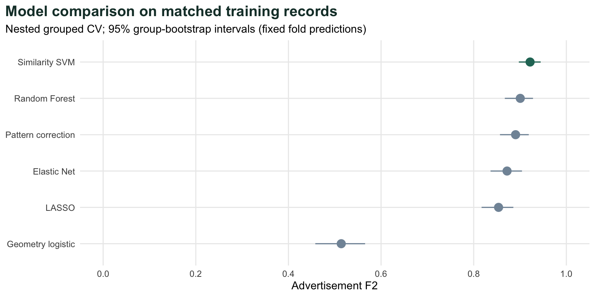
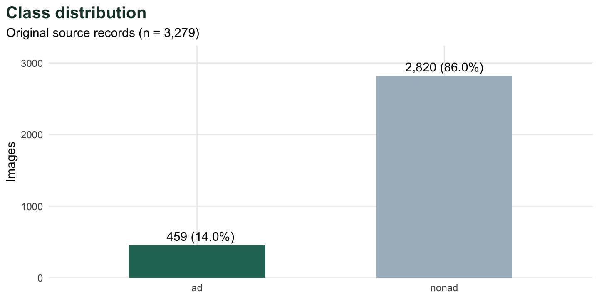
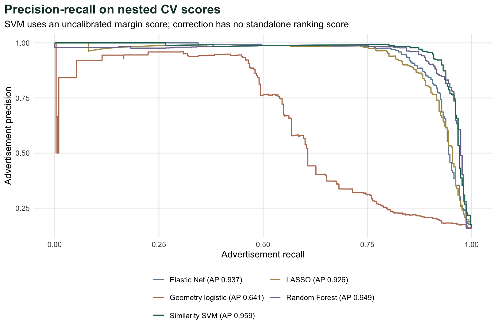
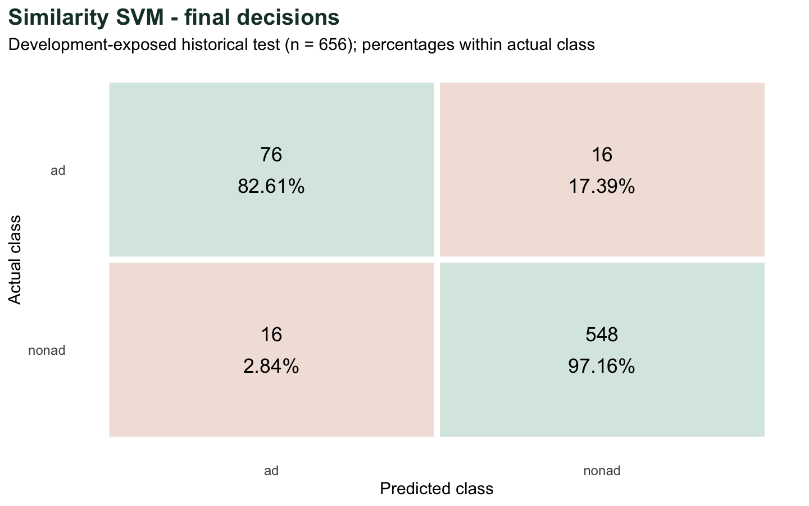

# Internet Advertisement Classification

A Probability and Statistics project that studies the geometry and URL/text features of online images and predicts **advertisement (`ad`)** versus **non-advertisement (`nonad`)**. R provides statistical analysis and regression; Python supplies Random Forest, similarity SVM and pattern correction.

[Methodology](docs/methodology.md) · [Reproducibility and prediction](docs/reproducibility.md) · [Model results](results/model_comparison.csv) · [Statistical results](results/statistical_summary.csv)

## Research objectives

- Measure geometric differences and associations with advertisement labels.
- Examine missing data, duplicates and conflicting labels without altering the source labels.
- Compare classifiers on matched groups, balancing advertisement recall against false alarms.

## Model comparison

<!-- key-results:start -->
**Nested grouped CV on 1,938 training records.** Intervals are 95% group-bootstrap intervals conditional on fitted fold predictions.

| Model | Accuracy | Ad precision | Ad recall | F2 [95% CI] |
|---|---:|---:|---:|---:|
| Geometry logistic | 90.66% | 89.94% | 46.43% | 0.514 [0.458, 0.566] |
| LASSO | 96.13% | 90.88% | 84.09% | 0.854 [0.817, 0.886] |
| Elastic Net | 96.23% | 89.30% | 86.69% | 0.872 [0.836, 0.904] |
| Random Forest | 96.90% | 90.52% | 89.94% | 0.901 [0.867, 0.928] |
| Similarity SVM (selected) | 97.32% | 90.76% | 92.53% | 0.922 [0.897, 0.945] |
| Pattern correction | 96.75% | 90.70% | 88.64% | 0.890 [0.857, 0.919] |

On the **development-exposed historical test** (656 records), the selected model achieves **95.12% accuracy**, **82.61% precision** and **82.61% recall**.

The accuracy-oriented legacy classifier achieves **96.49% accuracy** on that same historical partition. The CV-selected model does **not** establish a test-performance improvement.

CV results inform candidate selection; neither this CV comparison nor the development-exposed test is independent external validation.
<!-- key-results:end -->



The default follows the frozen training-CV selection rule. The minimum precision applies to selection estimates, not a guarantee on future data. Pattern correction remains an optional experiment; its label decisions have no standalone probability ranking.

## Dataset

[UCI Internet Advertisements](https://doi.org/10.24432/C5V011), created by Nicholas Kushmerick, contains extracted geometric and URL/text indicators rather than image files. The data were released in 1998 and are licensed under **CC BY 4.0**.

<!-- dataset:start -->
**3,279 records · 1,558 predictors · 459 ad · 2,820 nonad.** There are 910 rows with missing geometry, 856 exact duplicate rows and 3 predictor-profile groups with conflicting labels. Labels are preserved; counts come from the source records.
<!-- dataset:end -->



## Methodology

```text
data import and quality checks -> grouped partition -> descriptive statistics
    -> hypothesis tests and effect sizes -> fold-local model tuning
    -> nested CV comparison -> frozen selection -> historical evaluation
    -> validated public results
```

Welch tests compare geometric means; chi-square or Fisher tests examine binary associations. Confidence intervals, effect sizes, missingness analysis and Logistic Regression odds ratios retain the statistical focus. Benjamini-Hochberg adjustment covers the declared test families. Associations are not causal effects.

Six classifier candidates share the same outer/inner groups. The release uses five outer folds, three inner folds, seed **2026**, and training-only threshold selection. Its primary objective maximizes **F2 with precision at least 90% where feasible**; an explicit fallback handles infeasibility. Random Forest uses six controlled configurations. Outlier filtering/clipping is a sensitivity experiment excluded from automatic deployment. [Details and assumptions](docs/methodology.md)

## Key figures





These are the four published figures. Intermediate diagnostics and prediction matrices stay under ignored `outputs/`.

## Installation and execution

Use **R 4.6.2**, **Python 3.11** and **Make**. Run from the project root:

```bash
make setup
make download
make run
make publish-results
make check
```

`make setup` restores the R packages from `renv.lock` into a project library and installs the pinned Python dependencies into `.venv`. It stops if a locked version cannot be restored. `make run` regenerates analyses, models, uncertainty estimates and figures. `make publish-results` checks the completed run, exports the six public files and updates the tables above; missing, failed or stale inputs are rejected.

Predict a table of extracted UCI features:

```bash
make predict INPUT=features.rds OUTPUT=predictions.csv
```

Input must be a non-empty numeric RDS data frame matching `data/processed/feature_dictionary.csv`; use `NA` for unknown values. Output includes the class, score, score type and selected model. SVM scores are uncalibrated margins transformed by a sigmoid. [Input example, legacy interface and failure handling](docs/reproducibility.md#prediction)

## Project structure

```text
R/                    Statistical analysis, preprocessing and regression
classifier/           Python models, evaluation and R/Python bridges
scripts/              Setup, data download, execution, prediction and result export
tests/                Unit, integration, artifact and publication checks
docs/                 Concise methodology and reproduction notes
results/              Two verified CSVs and four release figures
data/                 Source/processed data, ignored except placeholders and guidance
.github/workflows/    Lightweight checks and a manual full-analysis workflow
config.R              Frozen release settings
requirements.txt      Pinned Python dependencies
renv.lock             Pinned R packages and runtime version
renv/                 R environment bootstrap and ignored local library
Makefile              Command interface
```

## Reproducibility and limitations

Results retain the source checksum, configuration fingerprint, analysis signature, software versions and figure hashes. Full audit files, selected-model manifests and intermediate results are regenerated locally in `outputs/`. The public snapshot can be checked without downloading data. [Reproduction details](docs/reproducibility.md)

The full workflow has been tested locally on macOS with R 4.6.2. GitHub Actions is configured for Ubuntu 24.04 with the same R version and lockfile; a successful hosted full-analysis run is still pending. Other R versions are not verified.

The dataset is small, old and imbalanced. Exact-profile grouping prevents literal duplicate leakage but cannot isolate all websites or near-duplicate images. CV informs model selection, and the historical test has influenced development. No independent external validation is available. Missingness, label conflicts and training variability remain limitations; conditional bootstrap intervals do not include domain shift or complete retraining uncertainty. Numerical differences across platforms or package versions are possible.

## References and credits

- Kushmerick, N. *Internet Advertisements*. [UCI, DOI: 10.24432/C5V011](https://doi.org/10.24432/C5V011). Dataset: CC BY 4.0. [Kaggle distribution](https://www.kaggle.com/datasets/uciml/internet-advertisements-data-set/data).
- Friedman, J., Hastie, T., & Tibshirani, R. (2010). Regularization Paths for Generalized Linear Models via Coordinate Descent. [Journal of Statistical Software](https://doi.org/10.18637/jss.v033.i01).
- [scikit-learn Random Forest documentation](https://scikit-learn.org/1.7/modules/generated/sklearn.ensemble.RandomForestClassifier.html).

A source-code license has not been selected; the repository owner must decide its terms before granting reuse permissions. Dataset attribution does not license the project code.
